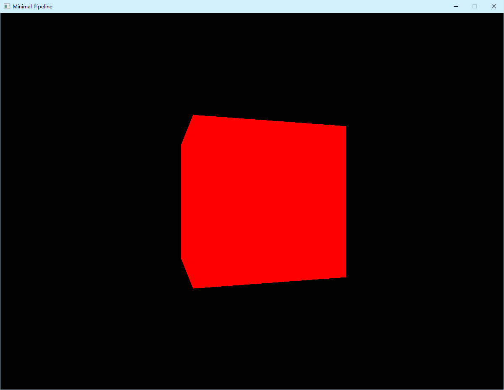

# 基于 C++ 和 EasyX 的 3D 图形绘制程序

我将在此处进行对已有代码的重新构建以及后续的程序开发。  

关于每一个库的说明，我会在后续的开发中进行详细的说明。  
如果把 API 全都放在这里，或许这个文件会显得非常臃肿。

使用教程参见：*HOW_TO_RUN.md*  
API 使用方法参见： *API速查.md*  
原理讲解参见：*原理文档.md*  

## 项目概览

### 特性

- 使用Eazyx库作为图形库，在其提供的 `putpixel()` 接口之上，**自行实现**三维坐标变换，而不依赖 `OpenGL` 、`Vulkan`等标准库  
- 使用技术： C++ 17 编程 、 EazyX 、 基础多线程

### 截至目前，已经实现的功能

具体以代码与开发日志为准。有些时候我会忘记更新这里的内容。

- 创建窗口
- 在窗口内逐像素绘制
- 在分支中实现简单的异步日志
- 渲染管线
    - 点（方向）的定义
    - 矩阵变换
        - 对点
        - 对方向
    - 物体基类
        - 可渲染物体
        - 相机物体
    - 网格
    - 最小可用渲染管线
- 渲染算法包
    - 深度缓冲
    - 深度测试
    - 绘制方法
        - 直线*（AI生成）
        - 三角形

### 截至目前，我希望可以实现的功能列表

如果功能已经实现，项会被直接从列表中被移除，并添加到上一板块中。  
\*越多，代表在构想中越应该提前实现的功能。  
\*的数量会随着项目进度调整。  

- 渲染算法 **
    - 颜色方法
        - 三元光栅 *
    - 优化方法
        - 基于法向量的背面剔除 **
        - 近平面裁切算法 **
    - 带纹理的渲染
    - 多线程渲染
- 物理算法
    - 基于微分近似方法矩阵形式的动力学模拟

## 我希望在构建这个项目的过程中学到一些什么？

首先就是计算机图形学的基础。  
	-  矩阵变换  
	-  光照模型  
	-  纹理映射  
	-  ……  
总之，至少我想跑通整个渲染管线。

第二，个人认为 AI 对于程序员是一个上手成本低且功能强大的工具。所以我希望在这个项目中能够学会如何使用 AI 来辅助程序开发。  
此外，我还希望借着重新构建、继续构建这个项目的机会，好好学习一下 Git 与 GitHub 的使用。

---

## 这个项目的预期产出形式是什么样的？
我希望这个项目最终能够产出一个可以被复用的头文件库，以及一本计算机图形学和3D引擎的学习开发笔记。

---

## 开发日志

时间会早于GitHub远程仓库所给出的提交时间。
所有时间都是北京时间（UTC+8）。

### 2026-10-16

#### **22:53** 

本提交不分配版本号：不涉及任何的代码迭代。

工程化改造：代码注释与文档维护

>  从这个提交开始，整个项目的后续更新将不仅仅是出于兴趣爱好与学习目的，更是本人所具有的工具与工程素养的最直观展现。

本项目开发过程中使用了 AI 辅助工具，但所有代码均经本人审阅、理解与修改。

- 文档
    - README 中删去大量个人自述章节。
        - > 这是出于工程化考量做出的决定。如果我希望一个项目具有高工程质量标准，那么 README 里面就应该集中展示项目而不是我。
    - 原 SKILLS 改名为 COVENTIONS ，并做出工程化的修改。
        - > 我觉得，使用 AI 不是一件令人羞耻的事情，剽窃 AI 才是。AI 是一个打字、查资料的速度比我快得多、效率比我高得多的一个伙伴。
        - > 我认为，如果我可以独立提供代码框架、讲清楚代码背后的原理，讲清楚我的代码为什么会这么编写、讲清楚我在实际开发过程中的取舍，那么这个代码就是我的。世界畅销书那么多，也没人说哪本书是排版工或者印书匠写出来的。
        - > 旧日志中的旧名引用予以保留。
- 源文件与头文件
    - 现在文件头部、函数头部的注释应该采用统一形式。
        - > 之所以注释风格不统一，是因为最初编写旧代码的时候我没有Doxygen插件，连打三个斜杠真的就只是连打三个斜杠，打 ///< 也不会把右半边的 > 补齐。当时因为这不影响注释的功能性予以保留。
    - 现在的文件头部版权署名应该为我的名字（如果我能确认我可以完全独立地编写这个文件），删去以及不应该存在的 AI 署名。
        - > 署名删去 AI 的条件，和文档更新中关于“代码是我写的”的界定一致。
        - > 比如，我现在还没办法讲清楚 Bresenham 直线绘制算法的运作原理（即便看了B站上的视频我也是一头雾水），这个文件以及这个函数的说明就应该标明AI生成。
        - > 比如，我在进行单元测试时为防止遗忘某一种情况，会请 AI 生成独立的单元测试代码然后运行，以保障代码不会遇到一些意料之外的使用工况，那么我就应该保留这个文件的 AI 署名。
        - > 再比如，我可以通过我记忆中高中向量的知识完全重写 `Vector3D` ，那么就应该删去这个库的 AI 署名。
        - > 原理文档恰好可以拿来干这个，不要看它是代码量的几十倍。它是我的学习笔记，体现了我对渲染管线（直到我实现功能为止）的掌握程度，也是界定我和 AI 的贡献的一把标尺。

- 取消文档里的喵喵叫，但是没有取消原理文档中的喵喵叫。

### 2026-10-07

#### **22：45** #01.05.01.1F

功能性更新
- 平面渲染方法
    - 位于RenderUtils.h
    - 伴随API、原理文档更新

附记：渲染线程分离以后，对原有代码的重构即可宣告完成。

### 2026-10-03

#### **23：21** # 01.04.01.1E

功能性更新
- 线性插值及其反解方法
    - 位于 ==./FernPack/math/MathUtils.h==
    - 伴随 API 文档更新
- Bresenham 绘制直线方法
    - 位于 ./FernPack/render/RenderUtils.h
    - 伴随 API 文档更新
- 创建正方体网格新添加棱的定义

源文件更新
- 新的源文件（Pipe02）是直线绘制算法的联调测试
- 旧的源文件（13）已被收纳
- 额外的源文件（14）是对直线绘制算法的单元测试

### 2026-10-02

#### **19:54** # 01.03.01.1D

源文件更新
- 新的源文件（Pipe01)是对深度测试绘制算法的联调测试。
    - 源文件主要调试深度测试算法在屏幕上的表现，
    - 需要说明的一点是，==有些时候立方体的渲染会出现异常。==
        - 因为我还没有实现直线的绘制和面的绘制算法，所以在渲染的时候，立方体的某些边缘在某些时刻会出现本来应该被遮住的部分被渲染的情况。
        - 我的临时面绘制函数对深度的计算是经过简化的。一个平面只有一个深度值，而不是每一个像素点都有一个深度值。
- 旧的源文件（13）已被收纳。

### 2026-10-01

#### **22：56** #01.02.01.1C

功能性更新
- 深度测试绘制算法
    - 位于 ==./FernPack/render/RenderUtils.h==
    - 伴随 API 文档更新
- 添加 `RenderTarget` 渲染目标类
    - 位于 ==./FernPack/render/RenderTarget.h==
    - 伴随 API 文档、原理文档更新

源文件更新
- 新的源文件（13）是对深度测试绘制算法的单元测试。
- 旧的源文件（12）已被收纳。

维护性更新
- SKILLS.md 中添加文件序号规则。

#### **02：17** #01.01.01.1B

功能性更新
- 深度缓冲
    - 位于 ==./FernPack/render/DepthBuff.h==
    - 伴随 API 文档更新
    - 原理文档中伴随更新深度缓冲类的实现原理与决策细节。

维护性更新
- 提出命名空间规范化标准
    - 组件所属命名空间应该遵循同一套规则，以避免名称冲突。分配规则为：
        - 经常被调用的核心类，只要名称足够独特，都不赋予二级命名空间。
            - 如`Vector3D`、`Matrix4x4`、`Window`。
        - 能明晰组件所属套装的，和套装一起赋予命名空间。
            - 如`Object`类因为是场景中物体的基类二被分配`Scene`二级命名空间。
        - 凡是在架构上属于某一套件的，都应该赋予一个套件的命名空间。
            - 如渲染算法相关类和函数应当被分配`Render`命名空间。
    - 可以在原理文档中查看更新内容。

源文件更新
- 新的源文件（12）是对深度缓冲类的单元测试。
- 旧的源文件（Ext01）已被收纳。

### 2026-9-30

#### **00：39** #01.00.01.1A.

Bug 修复
- ***真值表 Bug*** 于 `MathUtils.h`  下 `Ferrn::Math::isNearlyEqual()` 
    - 发现者与发现途径：
        - 人工审查代码
    - 函数预期工作机制：
        - 如果两个double分别为A和B，A和B的差值的绝对值小于指定阈值的时候判别两个浮点数相等。
        - A与B相等的充要条件为：A-B不足（小于）相等阈值，且B-A不足（小于）相等阈值。
        - 不依赖 fabs 判断两个double的差值绝对值是否小于指定阈值。
    - Bug 产生的机制：
        - A与B相等的充要条件被错误地解释成：A-B超过（大于）相等阈值，且B-A超过（大于）相等阈值。
        - 错误解释直接导致函数无论在任何给定输入下恒定输出 `false` 。
    - 受影响的模块与函数：
        - `Fern::Vecrot3D::operator==`
        - `Fern::Matrix4x4::opreator~`
        - `Fern::Matrix4x4::operator*`
    - 附记
        - debug的时候编译运行了一下项目，发现生成栏中对源文件调用 `Vector3D::operator==` 的位置报错：”重载函数具有类似的转换“。
            - 实际有效的解决方法是将 `Vector::operator==` 设置修饰符 `const`  
            
- 附带修复受以上Bug影响的函数，使其保持正确运行。

源文件更新
- 新的源文件（Ext01）是为以上的受影响函数重新编写的单元测试。
- 旧的源文件（11）已被收纳。

文档更新
- README.md 中新建板块列举任务列表。
- SKILLS.md 中添加指向远程仓库链接中 SKILLS.md 的链接。

版本号
- 提供简写形式。
    - #0100011A
- 提供分位形式。
    - #01.00.01.1A.

### 2026-9-28

#### ***23：30*** version_master#01000019

***里程碑更新***
- 新的源文件（11）是最小的可用渲染管线。
    - 现在运行项目可以在窗口中看见一个缓慢转动的纯红色立方体。如图所示。
- 旧的源文件（10）已被收纳。

版本号分配
- 版本号从这个里程碑更新开始分配。
    - 版本号规则：
        - 版本号数字部分采用十六进制，模255取余。
        - 所处分支。
        - 最高两位是里程碑数量。
        - 第三四两位是从上一个里程碑开始的迭代数。
        - 第五六两位是从上一个里程碑开始的bug发见数。
        - 最后两位是分支提交的commit数。

文档更新
- README更新大板块：第一个里程碑更新，我的感想是什么？
- SKILLS更新
    - 尝试让大肥鱼自己爬取文件目录树。
- API速查维护性更新
    - 预防找不到获取观察矩阵的方法，特别注明没有这个方法。

资源更新
- 添加Resources文件夹用以同步资源文件。
    - 位于： ./Resources

#### **21：50**

功能性更新
- `Camera`相机物体类
    - 位于： ==./FernPack/game_object/Camera.h==
    - 伴随 API 文档更新

文档更新
- 原理文档增量更新
- README文档增量更新

源文件更新
- 新的源文件（10）是对 `Camera` 类的单元测试。
    - 预期测试结果均为通过。
    - 实际测试结果均为通过。
- 旧的源文件（09）已被收纳。

注释维护
- `inline Matrix4x4 GeneratePerspectiveMatrix()`现在有注释了。在IDE里面就可以看到函数说明

#### **20：57**

功能性更新
- 投影矩阵生成函数
    - 位于： ==./FernPack/math/Perspective.h==
    - 伴随 API 文档更新

源文件更新
- 新的源文件（09）是对 `inline Fern::Matrix4x4 Fern::Perspective()` 的单元测试。
    - 预期测试结果均为通过。
    - 实际测试结果均为通过。
- 旧的源文件（08）已被收纳。

#### **20：09**

文档更新
- 原理文档中关于确定矩形大小的数学方法记载有误。现已纠错。

#### **20：06**

文档更新
- 原理文档修改NDC空间的定义
- 原理文档添加投影矩阵的实现原理与决策细节。

#### **05:23**

功能性更新
- 添加 `RenderObject` 可渲染物体类
    - 新建 =="./FernPack/game_object"== 文件夹下新建文件 ==RenderObject.h== 。
    - 伴随API文档更新。

文档更新
- 原理文档添加可渲染物体类的相关实现必要性及决策细节。
- SKILLS.md更新文件夹目录树。

源文件更新
- 新的源文件（08）是对 `class RenderObject` 的测试。
    - 预期测试结果均为通过。
    - 实际测试结果均为通过。
- 旧的源文件（07）已被收纳。

#### **03：47**

功能性更新
- 添加 `Mesh` 网格类。
    - 新建 =="./FernPack/game_object"== 文件夹下新建文件 ==Mesh.h== 。
    - 伴随API文档更新。

文档更新
- 原理文档添加网格类相关实现原理以及决策细节。
- SKILLS.md 更新文件夹目录树。

源文件更新
- 新的源文件（07）是对 `class Mesh` 的测试。
    - 预期测试结果均为通过。
    - 实际测试结果均为通过。
- 旧的源文件（06）已被收纳。

#### **01：57**

注释与文档维护
- 源文件添加文件头注释
- SKILLS.md 同步项目目录
- SKILLS.md 更新”在文件开头的注释“约定。

#### **01：36**

功能性更新
- 添加 `Object` 物体基类。
    - 新建 =="./FernPack/game_object"== 文件夹下新建文件 ==Object.h== 。
    - 伴随API文档更新。
- Matrix4x4 类新增静态工厂成员方法 `Rotation()` 。
    - 详情参见：*API 速查： Matrix4x4：预定义工厂方法*。

文档更新
- 原理文档添加物体基类相关实现原理以及决策细节。
- API文档指明每一个类的命名空间。
- 新建 SKILLS.md 便于大肥鱼读取更新。

源文件更新
- 新的源文件（06）是对 `class Object` 的测试。
    - 预期测试结果均为通过。
    - 实际测试结果均为通过。
- 旧的源文件（05）已被收纳。

### 2026-9-27

#### **17：30**   
功能性更新
- 更新矩阵的转置，以运算符重载完成这一功能。
    - 参见：*API 文档：`Matrix4x4::operator!`*
- 更新向向量应用矩阵变换的逻辑。现在：
    - `Matrix4x4::operator*` 专精空间点（带有点的意义的空间向量）的变换
    - `Matrix4x4::operator^` 专精法向量（带有方向的意义的空间向量）的变换
    - 同时保持一个运算符只做一件事情的逻辑。

文档更新
- 原理文档中写明此次更新的必要性、实现原理以及决策细节。
- 板块结构性优化

源文件更新
- 新的源文件（05）是对 `Matrix4x4::operator!` 和  `Matrix4x4::operator^` 的测试
    - == 测试 4 ：”转置的逆等于逆的转置“ ***理应不通过*** ，因为现在的矩阵求逆方法 `Matrix4x4::operator~` 只适用于仿射矩阵，而仿射矩阵转置以后不再是仿射矩阵，当矩阵不是仿射矩阵的时候，我的求逆方法会返回单位矩阵。 ==
- 旧的源文件（04）已被收纳（即放在旧的源文件文件夹下）

#### **02：40** 
文档更新
- 调整文档的跨平台渲染一致性

#### **02：19** 
文档更新
- 完善[原理文档]中关于矩阵求逆的算法实现的板块。  

  ~~预期的下一步更新是矩阵转置。因为后期预期实现法向量计算，而法向量跟随变换需要一种东西叫逆转置矩阵。~~  
  ~~一个矩阵的逆转置矩阵是先把这个矩阵求逆再转置这个矩阵的结果。~~  
  ~~由于要被用来求逆转置矩阵的矩阵是模型矩阵，而模型矩阵一定是仿射矩阵，所以接下来只需要专心致志实现转置就好。~~  

#### **00：40** 
迎来引擎重构之外的第一个功能更新
- 矩阵仿射变换求逆。
- 修复 `bool Fern::Math::isNearlyEqual()` 应该输出true但是输出false的反转输出问题。
- 新的源文件（04）用于验证求逆逻辑能否按照预期正常运转。
- 旧的源文件（03）被挪动到旧的源文件文件夹（./FernPack/outdated_sources）下。

